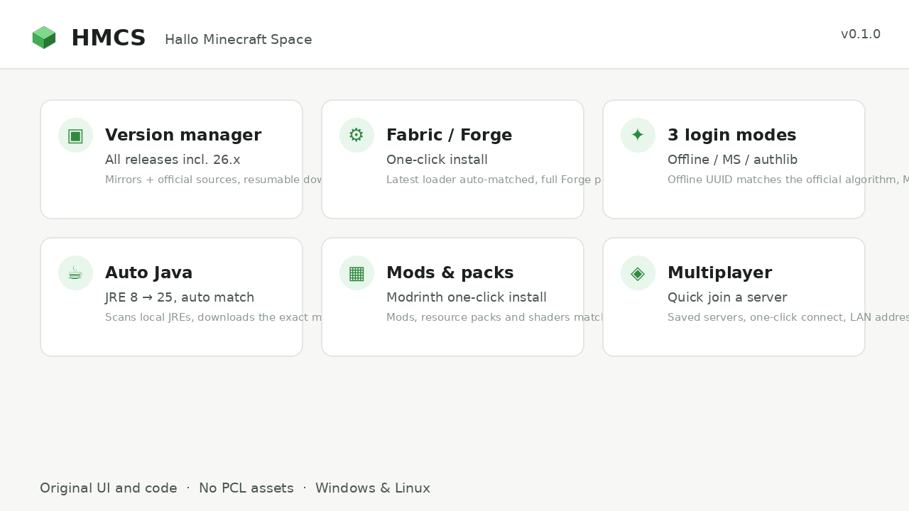

# HMCS — Hallo Minecraft Space

一个干净克制的 Minecraft 启动器，**界面与代码 100% 原创**（未使用 PCL 任何源码或素材），基于 Electron。



## 能做什么

- **版本管理** —— 正式 / 快照 / Beta 全量清单，包含 **26.x 年份版本**（26.1 / 26.2 / 26.3 …）。走 BMCLAPI 镜像与 Mojang 官方源双通道，**断点续传 + SHA1 校验**。
- **Fabric / Forge** —— 一键安装。Fabric 自动匹配最新 loader，Forge 完整跑 processors 安装管线。
- **三种登录** —— 离线账号（UUID 用官方算法生成）、微软正版（device code 流程）、authlib-injector 外置服（内置 LittleSkin 预设）。
- **Java 自动管理** —— 扫描本机 JRE，缺失时自动下载版本所需的那一个（Java 8 → 25，26.x 需要 Java 25）。
- **模组 / 资源包 / 光影** —— 在 Modrinth 上直接浏览安装，自动匹配游戏版本与加载器；也支持直接导入本地 `.jar` / `.zip`。
- **联机** —— 服务器列表、快速进服、局域网本机 IP 显示。
- **应用内更新** —— 启动器自动检查新版本并自我更新。

## 下载

| 平台 | 文件 | 说明 |
|---|---|---|
| Windows | `HMCS-0.1.0-win.zip` | 便携版。解压后双击 **`install.cmd`** 即可规范安装（开始菜单 + 桌面快捷方式 + 卸载项） |
| Linux | `HMCS-0.1.0-amd64.deb` | Debian / Ubuntu 安装包 |
| 源码 | `HMCS-0.1.0-source.zip` | 完整源码（MIT） |

## 安装（Windows）

1. 任意位置解压 `HMCS-0.1.0-win.zip`
2. 双击 **`install.cmd`** —— 会把 HMCS 装到 `%LOCALAPPDATA%\Programs\HMCS`，并创建快捷方式与卸载项
3. 运行 **HMCS.exe**

> 不想装也行：直接在解压目录里运行 `HMCS.exe` 功能完全一样，只是少了快捷方式。

## 安装（Linux）

```bash
sudo apt install ./HMCS-0.1.0-amd64.deb
```

## 第一次使用

- 在**下载**页选版本安装（剩下的启动器自己搞定）
- 在**账号**页加一个账号 —— 离线账号秒加
- 按下那个绿色大按钮，就开玩了

> **微软正版**需要自备 Azure Client ID：在 Azure Portal 注册 Public client 并启用 device code flow，把 ID 填到「设置 → 账号」。

## 运行环境

- Windows 10+ / x64 Linux
- **不需要**装 Java —— HMCS 会自己下载对应版本
- 首次运行需要联网

## 链接

- 源码：https://github.com/jaden175/hmcs
- 项目主页：https://jaden175.github.io/hmcs/

## 许可

MIT。界面与图标全部原创 —— 交互习惯对齐成熟产品，但未使用任何第三方启动器的代码与素材。
